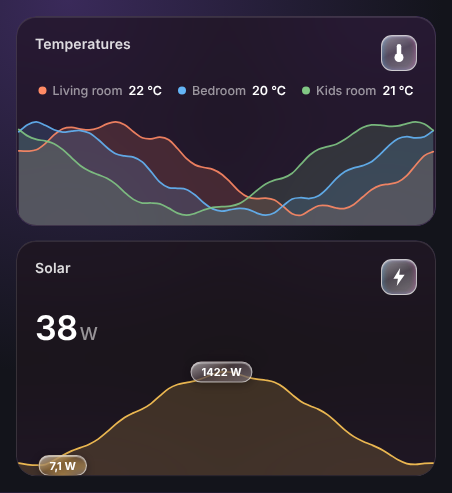

# Sensor Glass Chart Card

A frosted-glass multi-entity line chart for Home Assistant Lovelace, styled to match the [Liquid Glass](https://community.home-assistant.io/t/liquid-glass-tile-card-an-ios-26-liquid-glass-tile-card-for-your-dashboard/1016733) card family (`liquid-glass-tile-card`, `liquid-lens-navbar-card`). Built as a drop-in glass-styled alternative to `mini-graph-card` for multi-room/multi-entity history graphs (temperature, humidity, power, battery, etc.).



## Features

- **Multiple entities, one chart** — smoothed, resampled line + area chart for any number of sensors, auto-colored from a shared palette (same palette as `liquid-glass-tile-card-v2`, so a tile and a chart row referring to the same entity always share a color).
- **Legend with live values** — each row shows its current state + unit, not just a color key.
- **Single-row "hero" mode** — with exactly one row, the legend is replaced by a large glanceable number (like a tile card), avoiding a redundant duplicate value.
- **Hover-to-isolate (desktop) / tap-to-isolate (touch)** — hovering or tapping a legend name dims every other line so you can focus on one entity's curve. Tap again to show all lines.
- **Min/max "lens" pills** — while a line is isolated, its highest and lowest values in the visible window are shown as small frosted glass pills positioned right on the peak/valley of the curve. For single-row cards, the pills are shown permanently (there's no legend to interact with).
- **Full-bleed chart** — the graph runs edge-to-edge like a native card, not boxed in by the card's own padding.
- **Configurable time window, unit, and icon.**

## Installation

### HACS (recommended)

1. HACS → Frontend → ⋮ → Custom repositories → add this repo URL, category "Lovelace".
2. Install "Sensor Glass Chart Card".
3. Add the resource if HACS doesn't do it automatically (Settings → Dashboards → Resources).

### Manual

1. Download `sensor-glass-chart-card.js` from the [latest release](../../releases/latest).
2. Copy it to `/config/www/`.
3. Add as a dashboard resource: Settings → Dashboards → Resources → `/local/sensor-glass-chart-card.js`, type "JavaScript Module".

## Usage

```yaml
type: custom:sensor-glass-chart-card
title: Temperaturen
icon: temperature
unit: °C
hours: 12
rows:
  - entity: sensor.living_room_temperature
    name: Living Room
  - entity: sensor.bedroom_temperature
    name: Bedroom
    color: "#5ea8d9" # optional - overrides the auto palette
```

### Single-entity ("hero" mode)

```yaml
type: custom:sensor-glass-chart-card
title: Battery
icon: battery
unit: "%"
hours: 12
rows:
  - entity: sensor.solar_battery_level
    name: Charge
    color: "#66BB6A"
```

With exactly one row, the legend is hidden and replaced with a large current-value display, and the min/max pills are shown permanently.

## Configuration Reference

| Option | Level | Type | Description |
|---|---|---|---|
| `title` | Card | string | Card heading, shown top-left. |
| `icon` | Card | `temperature` \| `humidity` \| `battery` \| `power` | Icon shown in the glass icon-box, top-right. Omit for no icon. |
| `unit` | Card | string | Unit label applied to all rows. If omitted, each row falls back to its own entity's `unit_of_measurement`. |
| `hours` | Card | number | History window in hours shown on the chart. Default `24`. |
| `bg_opacity` | Card | number (0–1) | Overrides the glass background opacity. Default matches the rest of the Liquid Glass family (~70%). |
| `rows` | Card | array | The entities to chart (see below). Required, at least one. |
| `rows[].entity` | Row | string | Entity ID. Required. |
| `rows[].name` | Row | string | Display name. Falls back to the entity's `friendly_name`. |
| `rows[].color` | Row | string (hex) | Overrides the auto-assigned palette color for this row. |

## Design notes / technical details

- Chart geometry mirrors the approach used by [`mini-graph-card`](https://github.com/kalkih/mini-graph-card): the outer card carries no horizontal/bottom padding, only the header/legend get their own padding, and the SVG's height is left to the browser's intrinsic aspect-ratio handling (no fixed pixel height) rather than fighting a `preserveAspectRatio` mismatch. This is what makes the chart bleed to the card edges without a bleed/clip hack.
- The card matches its corner-clipping via both `overflow: hidden` **and** `clip-path: inset(0 round 20px)` on the outer card — `overflow: hidden` alone is unreliable together with `backdrop-filter` in some WebKit-based renderers (e.g. the HA Companion App), so `clip-path` is used as the robust fallback.
- History is fetched via `history/period` and matched back to configured rows by `entity_id` (present on the first record of each returned series), not by array position — the History API's per-entity ordering isn't a documented guarantee, and matching by position silently mismatches colors/curves if any entity has no data in the window.
- Legend DOM nodes are built once per config and only their text content is updated afterwards. Rebuilding the whole legend's `innerHTML` on every Home Assistant state tick (which fires constantly, for any entity in the system, not just this card's own) was found to make the browser synthesize spurious `pointerout`/`pointerover` events on the freshly recreated nodes — which flickered the hover-isolate feature on and off under a stationary mouse, in sync with unrelated HA traffic rather than actual mouse movement.

## License

MIT

## Changelog

### 1.3.1
- Only re-renders when one of the card's own entities changes, instead of on every state change in Home Assistant.
- Stops polling the history API while the card is not on screen (closed popup, other view) and refreshes when it comes back.
- "No history available" message follows the Home Assistant language.
